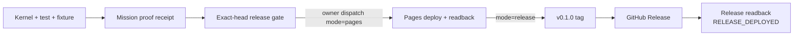

# gg_MATH

*Governed numerical methods provider for the GBOGEB federation.*

<!-- markdownlint-disable MD001 MD013 MD022 MD029 MD031 MD032 MD033 MD040 MD060 -->

[-orange?style=flat-square)](release/VERSION)
[](https://github.com/GBOGEB/gg_MATH/actions/workflows/release-infrastructure-v1.yml)
[](.python-version)
[](LICENSE)

> **gg_MATH owns the federation's mathematics: reference kernels for ranking, PCA and subspaces, uncertainty, scheduling and cost, each with tests and reproducible evidence — it supplies methods, never engineering decisions.**

## At a glance

| | |
|---|---|
| **Domain** | Reproducible numerical methods: Bradley–Terry ranking and uncertainty, PCA and subspace metrics, MANOVA, Monte Carlo, random-matrix calibration, DSM/makespan scheduling, cost estimation, temporal state metrics, Plotly visual evidence |
| **EPICs carried here** | **W260 / LM-10** math runtime promotion ([#27](https://github.com/GBOGEB/gg_MATH/issues/27)) · **U45** first release 0.1.0 and Pages ownership ([#109](https://github.com/GBOGEB/gg_MATH/issues/109)) · **U46** depth programme and method library ([#110](https://github.com/GBOGEB/gg_MATH/issues/110), [#133](https://github.com/GBOGEB/gg_MATH/issues/133)) |
| **Owner and decision authority** | Repository owner **GBOGEB**: admission to `main`, release dispatch, Pages ownership and every external grant. No agent, bot or CI verdict holds this authority. |
| **Role in the federation** | The *method provider*: neighbours pin a gg_MATH SHA and call its kernels; results carry method receipts, not acceptance. |
| **Owns** | [`kernels/`](kernels/), method cards and references in [`research/`](research/), mission proofs in [`mission/`](mission/), the release infrastructure in [`release/`](release/) |
| **Does not own** | QPS engineering decisions and release identity (cryoplant-project) · the canonical federation BT/PCA consumer and contracts (CODEX) · the DMAIC runtime (ABACUS) · census and routing (Hub) |
| **Status snapshot** | `main@ba1056b`, read 15 November 2026 — 4 open issues, 1 open PRs. [Details ↓](#6-status-and-open-gates) |

**New here?** Read [§1](#1-why-gg_math-exists--bios) (2 min), then the route that matches you:

| I want to… | Open this first |
|---|---|
| Find a method and how to use it | [What is inside](#3-what-is-inside) and the [method cards](research/MATH_METHOD_APPLICATION_CARDS_v1.yaml) |
| See the method references | [`research/MATH_METHOD_REFERENCES_v1.yaml`](research/MATH_METHOD_REFERENCES_v1.yaml) and the [research README](research/README.md) |
| Know when 0.1.0 ships | [Status and open gates](#6-status-and-open-gates) and [`release/README.md`](release/README.md) |
| Run the tests or a kernel | [Run it locally](#7-run-it-locally) |
| See what changed | [`CHANGELOG.md`](CHANGELOG.md) |

## 1. Why gg_MATH exists — BIOS

**B — Baseline.** `release/VERSION` declares **0.1.0**, still *unreleased*: no `v*` tag or GitHub Release exists yet. Release scope is source plus a hosted evidence site; it is **not** an installable Python package.

**I — Identity and integrity.** A release is cut only from one exact admitted SHA, with a runtime census, a manifest with SHA-256 receipts, and a readback that ends in `RELEASE_DEPLOYED`. Until then, mission runs are development evidence.

**O — Orchestration with ownership.** Each kernel lives once in `kernels/`, with a test and, where relevant, a reference fixture in `examples/`. Method dependencies are declared in [`research/MATH_METHOD_DEPENDENCY_GRAPH_v1.yaml`](research/MATH_METHOD_DEPENDENCY_GRAPH_v1.yaml).

**S — Safety and source-qualified status.** A test file that is neither collected nor run as a passing proof fails the release gate. Synthetic fixtures are labelled synthetic. A method result is evidence for a decision, never the decision.

**Who uses it:**

| Reader | Comes for | Leaves with |
|---|---|---|
| Analyst or engineer | A method with known assumptions | A kernel, its card and a reference fixture |
| Federation peer (CODEX, Hub, cryoplant) | A pinned provider | A gg_MATH SHA and method receipts |
| Reviewer | Whether a number can be trusted | Tests, uncertainty bounds and references |
| Owner | Release go/no-go | A green exact-head release gate and readback |

**Where authority lives:** [`release/VERSION`](release/VERSION) and [`CHANGELOG.md`](CHANGELOG.md) (identity) · [`release/MISSION_PROOFS_v1.yaml`](release/MISSION_PROOFS_v1.yaml) (proof census) · [`release/README.md`](release/README.md) (release procedure) · [`governance/`](governance/).

## 2. From source to decision

1. **Method card**: purpose, assumptions and references for the method.
2. **Kernel** in `kernels/`, stdlib or pinned dependencies only.
3. **Tests and reference fixture**: numerical checks against known values.
4. **Mission proof**: an exact-source workflow runs the method on its mission data and emits a receipt.
5. **Release gate**: runtime census, full test and proof census, manifest and SHA-256 receipts on one SHA.
6. **Publish** (owner dispatch): Pages → deployed readback → tag → GitHub Release → release readback.
7. **Consumers pin** the released SHA; the decision stays with the consuming repository.

## 3. What is inside

| Block | Native source | Input → output | Boundary |
|---|---|---|---|
| Linear algebra | [`matrix_core.py`](kernels/matrix_core.py) | Matrices → SVD, pseudoinverse, Jacobi eigensystem | Reference implementation, not optimized |
| Ranking | [`bradley_terry.py`](kernels/bradley_terry.py), [`bt_uncertainty.py`](kernels/bt_uncertainty.py) | Pairwise comparisons → scores with bootstrap intervals | Ranking ≠ selection decision |
| PCA and subspaces | [`pca_reference.py`](kernels/pca_reference.py), [`pca_alignment.py`](kernels/pca_alignment.py), [`pca_uncertainty.py`](kernels/pca_uncertainty.py), [`subspace_metrics.py`](kernels/subspace_metrics.py), [`generalized_subspace_metrics.py`](kernels/generalized_subspace_metrics.py) | Data → components, stability, principal angles | Stability bounds are stated per run |
| Statistics and uncertainty | [`stats_core.py`](kernels/stats_core.py), [`uncertainty.py`](kernels/uncertainty.py), [`manova_reference.py`](kernels/manova_reference.py), [`monte_carlo_uncertainty.py`](kernels/monte_carlo_uncertainty.py) | Samples → intervals, MANOVA, propagated uncertainty | Assumptions in the method card |
| Random-matrix and signal | [`rmt_calibration.py`](kernels/rmt_calibration.py), [`rmt_signal.py`](kernels/rmt_signal.py), [`spectral_graph.py`](kernels/spectral_graph.py) | Spectra → noise floor, signal separation | Calibration per data set |
| Temporal | [`temporal_pca_receipt.py`](kernels/temporal_pca_receipt.py), [`temporal_state_metrics.py`](kernels/temporal_state_metrics.py), [`temporal_subspace_trace.py`](kernels/temporal_subspace_trace.py), [`stochastic_dynamics.py`](kernels/stochastic_dynamics.py) | Time series → state metrics, subspace traces | Research grade unless a mission proof says otherwise |
| Scheduling and cost | [`dsm_makespan.py`](kernels/dsm_makespan.py), [`dw_spm.py`](kernels/dw_spm.py), [`seed_tree.py`](kernels/seed_tree.py), [`cost_estimation.py`](kernels/cost_estimation.py), [`portfolio_longitudinal.py`](kernels/portfolio_longitudinal.py) | DSM/plans → CPM makespan, bounds, cost estimates | Docs in [`docs/`](docs/); estimates, not commitments |
| Visual evidence | [`multidimensional_visuals.py`](kernels/multidimensional_visuals.py), [`visual_engine_bridge.py`](kernels/visual_engine_bridge.py) | Results → Plotly HTML | A view, not a source |
| Mission proofs | [`mission/`](mission/) (LM10, M02B, QPS, Grand Mission I-B temporal PCA, SPINE travel W13, federation) | Mission data → receipts | Mission-scoped evidence |
| Release infrastructure | [`release/`](release/) | Exact SHA → census, manifest, Pages site, tag, release, readback | Runs only by owner dispatch |

## 4. Where gg_MATH sits in the federation

| Neighbour | Keeps | Interface with gg_MATH |
|---|---|---|
| [CODEX](https://github.com/GBOGEB/CODEX) | Canonical federation BT/PCA consumer, contracts | Consumes method references and receipts |
| [pipeline-automation-hub](https://github.com/GBOGEB/pipeline-automation-hub) | Census and routing | Pins gg_MATH as a provider (rebind tracked in [Hub #1203](https://github.com/GBOGEB/pipeline-automation-hub/issues/1203)) |
| [cryoplant-project](https://github.com/GBOGEB/cryoplant-project) (private) | QPS decisions, cost models | Uses BT, DoE and cost methods; owns the decisions |
| [ABACUS](https://github.com/GBOGEB/ABACUS) | DMAIC runtime | Runtime peer; no shared kernel copies |

## 5. Process diagrams

Declared release path, not a run receipt.



## 6. Status and open gates

**Snapshot: `main@ba1056b`, read 15 November 2026.** Rows point at live owners; open the link for the current position.

| Gate | Status | What would close it |
|---|---|---|
| First release 0.1.0 | **Not released**: no `v*` tag, no GitHub Release ([#109](https://github.com/GBOGEB/gg_MATH/issues/109)) | Governed `mode=release` run with a `RELEASE_DEPLOYED` readback |
| Pages ownership | Pages is enabled, but `jekyll-gh-pages.yml` deploys the repo root on every push and would overwrite the governed release site | Owner picks the workflow that owns the Pages root |
| Hardening wave H | Merged ([#130](https://github.com/GBOGEB/gg_MATH/pull/130)); path confinement merged ([#131](https://github.com/GBOGEB/gg_MATH/pull/131)). Zero open code-scanning alerts is **unverified** (inventory not readable by the integration) | Alert inventory read back as 0 |
| Kernel backlog | Set similarity and plane geometry kernels open in [#136](https://github.com/GBOGEB/gg_MATH/pull/136) | Merged with tests and fixtures |
| Depth programme | Method library merged ([#134](https://github.com/GBOGEB/gg_MATH/pull/134)); follow-ups in [#110](https://github.com/GBOGEB/gg_MATH/issues/110), [#133](https://github.com/GBOGEB/gg_MATH/issues/133) | Review committed to `research/`, depth items filed |
| `main` protection | Rulesets: PR required, Copilot review, code scanning and code quality; required checks *Exact-head release gate*, *first-kernel*, *signal-stack*, *deterministic-w011*, *monte-carlo-reference* | — |
| Workflow estate | 37 workflow files at this snapshot | Each entrypoint accounted for in the proof census |

## 7. Run it locally

Python **3.11** is the declared runtime ([`.python-version`](.python-version)). From the repository root:

```bash
python -m pip install -r requirements-release.txt -c release/constraints-release.txt
python -m pytest tests -q                  # collectable tests only
python release/mission_proofs.py run      # runs the script-mode proof files pytest does not collect, plus workflow accounting
python release/runtime_census.py          # check your environment against the lock
python research/consolidation_lab.py      # local research pilot
```

## 8. Evidence rules and non-compensation

- **Zero collected is a failure**: every `tests/test_*.py` is collected or run as a passing proof.
- **Exact head only**: release evidence is bound to one SHA; older green runs do not carry over.
- **Unreleased means unreleased**: 0.1.0 exists only after the release readback says `RELEASE_DEPLOYED`.
- **Methods, not decisions**: no kernel output grants engineering, procurement or release credit.
- **Unverified stays unverified**: a check the integration cannot read is reported as such, not as zero.

## 9. Repository map and next actions

| Folder | Open it for |
|---|---|
| [`kernels/`](kernels/) | Every method implementation |
| [`tests/`](tests/) | Numerical and governance tests |
| [`examples/`](examples/) | Reference fixtures and synthetic cards |
| [`docs/`](docs/) | Kernel notes (cost, DSM makespan, DW-SPM, seed tree, portfolio) |
| [`research/`](research/) | Method cards, references, dependency graph, research registers |
| [`mission/`](mission/) | Mission-scoped proofs and receipts |
| [`release/`](release/) | Release gate, publisher and readback |
| [`governance/`](governance/), [`tools/`](tools/), [`scripts/`](scripts/) | Branch hygiene and CI helpers |

**Next actions** (match §6): owner decides Pages ownership → read back the code-scanning inventory → dispatch `mode=pages` rehearsal → dispatch `mode=release` for 0.1.0 → land #136.

---

BIOS: Baseline · Identity · Orchestration · Safety. Release authority: **GBOGEB**. Licence: [Apache-2.0](LICENSE). Landing R2 on the [GEMINI skeleton](https://github.com/GBOGEB/GEMINI/blob/main/docs/landing/LANDING_SKELETON.md), snapshot `main@ba1056b`.
