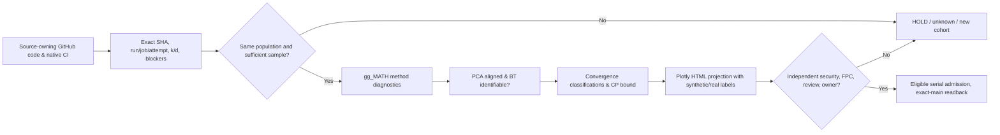

# gg_MATH / G3P — Convergence, Blockage, Stability and Practical Capability

**Scope:** Source-bound method proof in [draft provider PR #61](https://github.com/GBOGEB/gg_MATH/pull/61). `kernels/convergence_control.py` owns estimators, existing gg_MATH `pca_alignment.py` and `bradley_terry.py` own mathematical references, `mission/federation/convergence_dashboard.py` builds an outward **synthetic Plotly proof**, and MissionControl is a consumer. All displayed examples are **synthetic, not live repos**. No engineering acceptance, Six Sigma process certification, or security waiver is inferred.

## 1. Separate the clocks and denominators

- `N`: monotone pulse index, **not** elapsed minutes or an IID trial.
- `k_N / d`: counted eligible covered items out of a **fixed matched denominator d**. Changed denominator/scope is a different cohort, not an improvement or regression estimate.
- `C_N=100k_N/d` (%); `v_N=(C_N-C_{N-1})/(N-(N-1))` (pp per indexed pulse); `a_N=(v_N-v_{N-1})/delta_N` (pp per pulse²).
- Rolling median velocity and median absolute deviation are **descriptive** diagnostics, not confidence intervals.
- Native exact commit/run/attempt and UTC wall time remain separate source clocks; matched issuer roots, reviewer gates, build paths and QPS child authority remain distinct.
- `SOURCE_BOUND_UNVERIFIED_RECEIPTS` means **locators supplied** but not GitHub authenticated by the math function. `SYNTHETIC_REFERENCE` is never production metric credit.

## 2. Unambiguous regime decision table

| Diagnostic state | Numerical/structural trigger | What it permits | What it does **not** claim |
|---|---|---|---|
| `PROGRESSING` | Latest matched velocity exceeds preregistered +ε | Improvement exists on this denominator | Broad repo closure / independent acceptance |
| `REGRESSING` | Latest velocity below -ε | Investigate cause or population | Causality from raw slope |
| `PLATEAU_DESCRIPTIVE_NOT_PROVEN_STABLE` | At least last 3 matched velocities in [-ε,+ε] | Low movement observed | Equivalence, final completion or true asymptote |
| `BLOCKED_UNTIL_OWNER_EVIDENCE` | Owner-owned gate/root blockers nonempty | Diagnose/unblock before numerical progress claims | “Stable”, “done”, green KPI |
| `NEAR_FINITE_CAP_DESCRIPTIVE` | Plateau and `100-C_N<=cap_tol_pp` | Close to **defined arithmetic cap** | Six Sigma, infinite-horizon asymptote, qualitative coverage completeness |
| `EQUIVALENCE_ESTIMATE_PASS_PROVENANCE_UNVERIFIED` | Two one-sided t tests, 90% interval fully inside ±ε, explicit unique/disjoint replicates | Candidate tolerance-equivalence estimate | Independently attested experiments until original receipts are read back |
| `INSUFFICIENT_TEMPORAL_DEPTH` | Few matched N points without actionable direction | Request more temporal observations | Stable/non-moving |

Blocked is evaluated **before** flatline so a red gate cannot become a green equilibrium. FPC or missing artifact receipts are external causes, not a sign of mathematical convergence.

## 3. Inference / DoE / Six Sigma

**Fixed-horizon equivalence (TOST):** preregister tolerable change `epsilon` in percentage points. On independent/disjoint reference experiments, estimate mean delta `m` and standard error `s/sqrt(n)`. The 90% two-sided t interval `m ± t_(0.95,n-1)s/sqrt(n)` must lie strictly within `(-epsilon,+epsilon)` for equivalence at one-sided alpha 0.05. Current implementation requires >=8 declared independent replicates; the estimator **cannot authenticate independence**, so any claimed equivalence remains provenance-unverified until external source owner readback. IID/model assumptions, repeatability, multiple-testing and stopping rules must be checked before inferential adoption.

**Six Sigma capability:** define a customer-facing *critical-to-quality* (CTQ) defect and actual independent defect opportunities before counting. `DPMO=1e6*d/n`. Use the one-sided 95% Clopper–Pearson upper bound: if `d=0`, `p_upper=1-0.05^(1/n)`. One hundred clean independent opportunities only give a ~29,513 DPMO upper bound; ~**881,097 independent zero-defect opportunities** are needed for the upper bound to reach <=3.4 DPMO. `3.4 DPMO` is the **conventional 1.5-sigma-shifted** Six Sigma benchmarking convention, not proof of a literal stationary ±6σ process or physical asymptotic achievement. Repeated tests over the same underlying defects **are not independent opportunities**. CI failure absence, passed test percentage or branch coverage is never a Six Sigma capability proof.

**PCA (descriptive geometry):** fit PCA only to comparable standardized feature sets on sampled measurement populations; assign components, align arbitrary signs, assess eigengaps, p/n and loading congruence. A PC1 >89% variance share is not a time-stability certificate. Two congruent fits with ambiguous eigenvalues or small `n/p` are not strong proof; uncertainty requires independently sampled bootstrap or valid perturbation model and stable subspace geometry (principal angles, projection distance) as the rank changes.

**Bradley–Terry (comparative decisions):** rank owner or method alternatives **only** when the directed win graph admits a finite unregularized MLE (strong connectivity); disconnected/separated data are `UNIDENTIFIABLE_OR_SEPARATED`. Equality of rankings across two windows is descriptive. Certify comparative stability only with enough distinct authentic comparisons, source-stable alternative universe, finite Fisher information or robust bootstrap rank intervals, calibration checks, and a preregistered rank-flip tolerance. BT is not a substitute for engineering safety/security admission and it does not establish causal root resolution.

## 4. DMAIC supervisor and conditional MIP

| DMAIC | Output / gate | Conditional MIP |
|---|---|---|
| DEFINE | Freeze exact repository/source/pulse, population, owner, objective, CTQ, blocked gate and stopping criteria | Modernize only for measured friction or defect |
| MEASURE | Exact run/job/attempt + k/d + opportunity data + forecast frozen ahead of actual | Avoid invented Δ / swapped denominator |
| ANALYZE | First-red vs propagations, temporal slope, PCA subspace, BT graph, interval width and DoE power | Innovate method capability if diagnostics show an actual gap |
| IMPROVE | One bounded disjoint source-owner correction, tests, native artifact | Improve only under authorized 3PC |
| CONTROL | Terminal exact-head native output, hover/zoom/viewport visual QA, match forecast vs actual; record residual BD / owner | Perpetuate only after independent qualification |

### Reference N/N+1/N+2 learning

Freeze a forecast at N for N+1/N+2 (value, interval, assumptions, SHA). On the next observed pulse record signed forecast error and actual matched denominator without retroactively changing prediction. The provider does not turn a forecast, even a correct one, into a code acceptance.

## 5. SIPOC, gate DAG and owner duties

| SIPOC | Scope |
|---|---|
| **Supplier** | Owner repository CI, authenticated counters, independent experiments |
| **Input** | Run/attempt SHA and workflow state, fixed cohort, CTQ/opportunity metadata, PCA/BT fits/pairs |
| **Process** | Provenance check → estimate → diagnose → classify → display → exact-head verify |
| **Output** | Source-scoped typed receipt, Plotly HTML/JSON, QA screenshot/checks, BD next-owner |
| **Customer** | MissionControl read-only controller and source owners, not delegated security/QPS approver |

**Engineering decision:** a red A10, Safety, FPC or nonvalidated QPS artifact remains HOLD no matter how favorable the statistical plot appears. All reference receipts carry `authority_transfer=false`, `merge_admission=HOLD`. Do not auto-fanout or overwrite inherited repository authority.

## 6. Visual QA and publication stages

Generated HTML is an artifact with Plotly embedded offline once. Required three viewports (1440×1000, 1280×800, 390×844), zero console/page errors, zero horizontal overflow, six initialized figures, filters, zoom/close, source SHA in view, screenshot captures and SHA-256 manifest.

Stage ladder: **source-committed → native QA terminal → eligible reviewer approval → merged main → exact-main readback → separately verified Pages**. A passing plot or GitHub action artifact is not a deployed Pages URL. Plotly figures are **generated projections** of typed math evidence; they must not mutate source ledgers.
