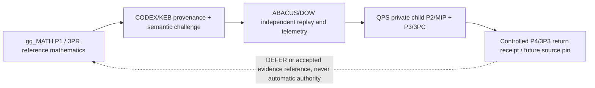

# QPS / gg_MATH P4 wormhole — governed provider contract v1

**Status:** proposed federation interface, not executed cross-repository acceptance. Primary parent: `GBOGEB/cryoplant-project` (`QPS TRIAGE`); no public repository owns child engineering decisions.

## Uniform topology



Provider artifact and P4 contract use `mission/federation/qps_wormhole.py`.
The QPS child contract is `controls/QPS_TRIAGE_CHILD_CONTRACT_v1.json`; the existing QPS method-card binding is `controls/QPS_MATH_METHOD_CARDS_CURRENT_v0.1.yaml`.
Preserve the historical W259 P4 route and do not overwrite its accepted knowledge-only receipts.
The parent/child control pointer `QTG_CURRENT.yaml` is volatile and remains unchanged.

## Data and authority

Public outbound: schema, 40-hex source SHA, canonical artifact path, SHA-256 digest of public method artifact, synthetic method ID/population, wave/pulse, explicit authority restrictions. No private bid/tender/negotiation content, raw QPS vectors or person identifiers.
`PROPOSED_UNVERIFIED` must never be represented as `PASS`. No run/job IDs are fabricated. Hash integrity is not an authentication proof; the consumer must obtain the same native GitHub artifact, run and SHA independently.
Mathematical kernels must not turn PCA into observed BT outcomes. QPS owns project-governed thresholds.

## Canonical 3P* / MIP roles

1. **P1 / 3PR:** gg_MATH refreshes method and publishes reference/challenge provenance.
2. **P2 / MIP:** QPS private child binds its own population, denominator, units and source; external reference is read-only.
3. **P3 / 3PC:** QPS owner performs Prepare / Prove / Commit; `ACCEPT/REJECT/DEFER` cannot be delegated to a math provider.
4. **P4 / 3P3:** Preserve/Pin -> Propagate/Penetrate through KEB and DOW -> Prove/Promote *evidence only* with independent re-entry and matching run receipts.

## Acceptance and metrics

- Provider deterministic second run produces byte-identical JSON when input and source SHA are unchanged.
- Tests reject altered source/artifact digest, extra/private fields, QPS state promotion, fake runs, route alterations, BT claims, and unsafe filesystem paths.
- DOW consumer records validated/eligible/missing/invalid counts; missing provider evidence is `DEFER`, never zero.
- Private QPS re-entry remains `DEFER` without independent KEB and DOW evidence and QPS-owned disposition.
- DoD: source and tests committed, PR exact-head green. DoV: native provider/Keb/DOW/QPS replay with authenticated source receipts, independent review and protected-branch admission. Neither is claimed here.


## Deep-bridge v1.1: separate local source proof from cross-repo native acceptance

`qps_hop_census.py` extends, rather than replaces, the existing `qps_wormhole.py` envelope. It receives one ordered hop claim for each repository and enforces this 4-lane route:

| Plane | Repo | Evidence owner | Mutability |
| --- | --- | --- | --- |
| P1 / 3PR | gg_MATH | Synthetic math/reference artifact digest, frozen method/units/population | Provider-only |
| P4 control / KEB | CODEX | Read-only semantic challenge, orchestration and future native run receipt | No QPS acceptance |
| P4 replay / DOW | ABACUS | Independent replay, LDAB/CI lineage and telemetry joins | No QPS acceptance |
| P2/P3 child | cryoplant-project | Real QPS evidence, engineering/compliance/negotiation decisions | QPS owner-only |

**Mandatory dual proof:** local SHA-256 source verification is only `VERIFIED_SOURCE`. The census intentionally records `native_verified_hops=0` and `completion_fraction=null` until future authenticated run/job/artifact receipts and QPS owner dispositions are independently supplied. The current utility does **not** fetch those claims or promote them.

### Ordered Prepare / Prove / Commit / Propagate path

1. Prepare: QPS owner defines purpose, units, population and non-sensitive reference scope.
2. Prove provider: gg_MATH creates deterministic v1 proposal and passes negative tests; verify exact artifact bytes and source SHA.
3. Prove KEB and DOW independently: CODEX and ABACUS each consume immutable reference artifacts into their own typed receipts, attached to their exact checked-out SHAs and real native runs. Do not overwrite provider artifacts or return self-declared PASS.
4. Commit: QPS independently checks project authority, engineering controls, denominator and permitted evidence before ACCEPT/REJECT/DEFER.
5. Propagate: only evidence references flow back upstream, never raw private QPS content or acceptance power.

### Convergence and instrumentation

Let `H=4`, `h_s` be source-verified hops, `h_n` be independently native-verified hops and `h_m` be missing/unknown hops. Report the **pair** `(h_s/H, h_n/H)`; do not confuse local source integrity with native federation completion. Do not treat absent values as zero observations or as a successful empty sample. Count unique root IDs and disjoint leases in ABACUS separately from raw scanner/CI checks. Preserve same source SHA, scanner/tool version and selection before computing before/after deltas.

### Read-only local example

```bash
python -m unittest discover -s tests -p 'test_qps_hop_census.py' -v
python mission/federation/qps_hop_census.py \
  --proposal artifacts/qps_wormhole/proposal.json \
  --claims path/to/four-hop-claims.json \
  --artifact research/MATH_METHOD_DEPENDENCY_GRAPH_v1.yaml \
  --out artifacts/qps_wormhole/hop-census.json
```

Claims comprise `repo, role, source_sha, run_id, job_id, state`, in route order. Only the provider may claim `VERIFIED_SOURCE`, and only with an exact matching SHA and independently supplied artifact bytes. Neither a proposed claim nor a source-level digest is an executed GitHub workflow receipt.

**DoD:** exact-head tests and deterministic receipts. **DoV:** separate, trusted CODEX/ABACUS execution receipts and QPS owner replay. Both branch-protection and independent security admission remain external gates.
