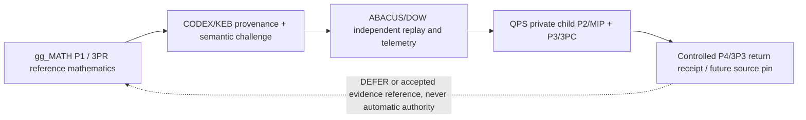

# QPS / gg_MATH P4 wormhole — governed provider contract v1

**Status:** proposed federation interface, not executed cross-repository acceptance. Primary parent: `GBOGEB/cryoplant-project` (`QPS TRIAGE`); no public repository owns child engineering decisions.

## Uniform topology

Provider artifact and P4 contract use `mission/federation/qps_wormhole.py`.
The QPS child contract is `controls/QPS_TRIAGE_CHILD_CONTRACT_v1.json`; the existing QPS method-card binding is `controls/QPS_MATH_METHOD_CARDS_CURRENT_v0.1.yaml`.
Preserve the historical W259 P4 route and do not overwrite its accepted knowledge-only receipts.
The parent/child control pointer `QTG_CURRENT.yaml` is volatile and remains unchanged.

## Data and authority

Public outbound: schema, 40-hex source SHA, canonical artifact path, SHA-256 digest of public method artifact, synthetic method ID/population, wave/pulse, explicit authority restrictions. No private bid/tender/negotiation content, raw QPS vectors or person identifiers.
`PROPOSED_UNVERIFIED` must never be represented as `PASS`. No run/job IDs are fabricated. Hash integrity is not an authentication proof; the consumer must obtain the same native GitHub artifact, run and SHA independently.
Mathematical kernels must not turn PCA into observed BT outcomes. QPS owns project-governed thresholds.

## Canonical 3P* / MIP roles

1. **P1 / 3PR:** gg_MATH refreshes method and publishes reference/challenge provenance.
2. **P2 / MIP:** QPS private child binds its own population, denominator, units and source; external reference is read-only.
3. **P3 / 3PC:** QPS owner performs Prepare / Prove / Commit; `ACCEPT/REJECT/DEFER` cannot be delegated to a math provider.
4. **P4 / 3P3:** Preserve/Pin -> Propagate/Penetrate through KEB and DOW -> Prove/Promote *evidence only* with independent re-entry and matching run receipts.

## Acceptance and metrics

- Provider deterministic second run produces byte-identical JSON when input and source SHA are unchanged.
- Tests reject altered source/artifact digest, extra/private fields, QPS state promotion, fake runs, route alterations, BT claims, and unsafe filesystem paths.
- DOW consumer records validated/eligible/missing/invalid counts; missing provider evidence is `DEFER`, never zero.
- Private QPS re-entry remains `DEFER` without independent KEB and DOW evidence and QPS-owned disposition.
- DoD: source and tests committed, PR exact-head green. DoV: native provider/Keb/DOW/QPS replay with authenticated source receipts, independent review and protected-branch admission. Neither is claimed here.
